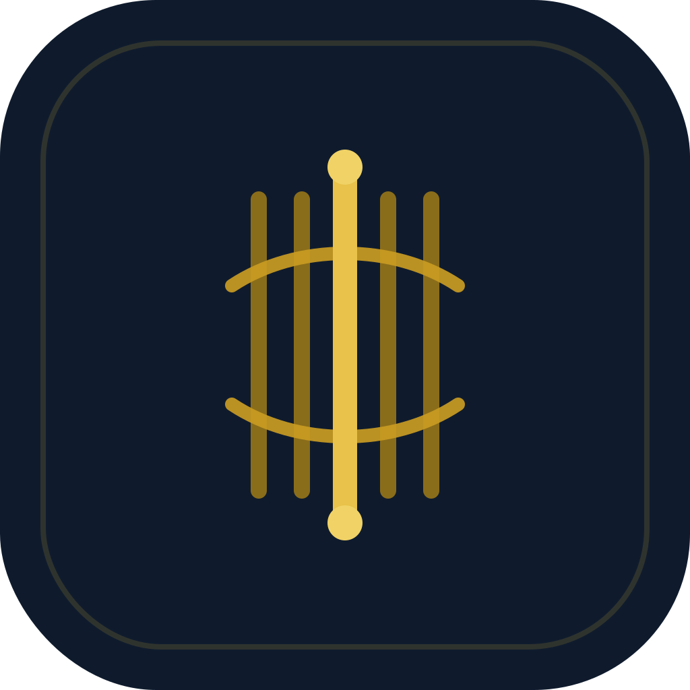
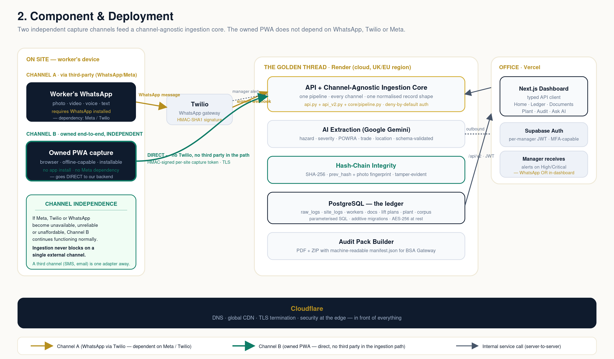
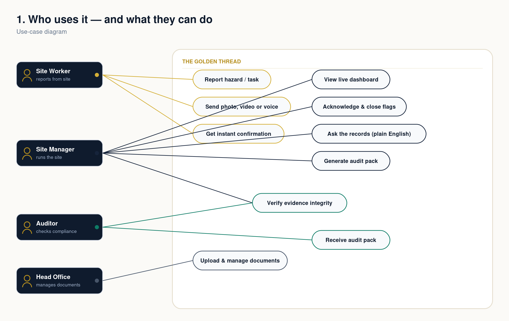
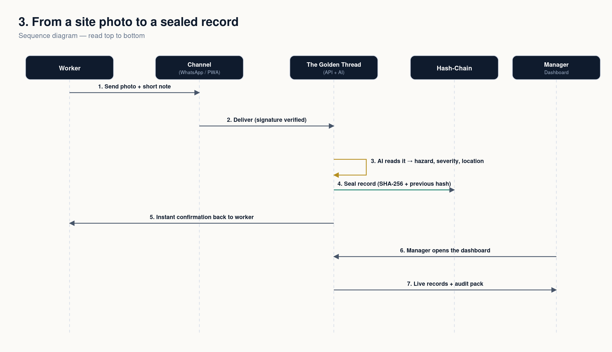
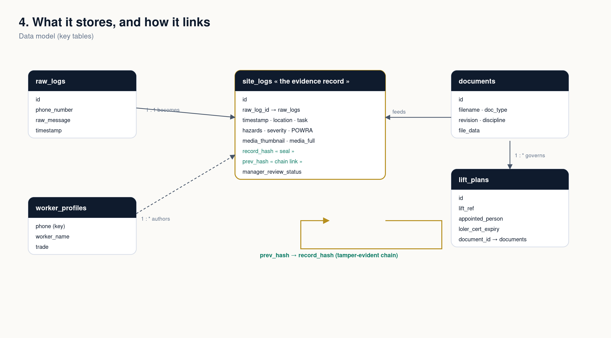

# 36 Golden Thread — Case Study

**A deployed UK construction-compliance platform that turns everyday site messages into audit-ready, tamper-evident safety records.**

> This is a **case study**. The production code is private (it's a real product with a pilot). I'm happy to give a walkthrough or read-access on request.

**Live:** [goldenthreadledger.co.uk](https://goldenthreadledger.co.uk) · **Dashboard:** app.goldenthreadledger.com

---

## The problem
Under the UK Building Safety Act, construction has a legal duty to keep a **"golden thread"** — a continuous, auditable record of safety information. But on site, hazards get reported informally (WhatsApp, word of mouth) and rarely end up in an audit-ready form. When an inspection or incident happens, the evidence trail is full of holes.

## What I built
A worker reports a hazard the way they already do — a **WhatsApp message** or the platform's own **offline web app** — and it becomes a structured, timestamped, **tamper-evident** safety record, ready for a Building Safety Act audit.

- **Zero-friction capture** — WhatsApp (Twilio) or an installable offline PWA; photo, video or voice.
- **AI structuring** — each report is parsed by an LLM into a structured record: location, trade, task, hazard, severity, POWRA category.
- **Tamper-evident ledger** — records are sealed so the audit trail can't be quietly altered.
- **Role-based views** — field workers; managers (acknowledge / close, Ask-AI Q&A); audit export.
- **One-click audit pack** — an evidence bundle an inspector can actually use.

## Architecture

- **Backend:** FastAPI + uvicorn, deployed on Render
- **AI:** Google Gemini + Anthropic (report structuring + Q&A)
- **Data / auth:** Supabase — Postgres with row-level security, per-manager auth
- **Intake:** Twilio WhatsApp + first-party offline PWA
- **Frontend:** progressively rebuilt Streamlit → server-rendered HTML dashboard → Next.js + TypeScript + Tailwind
- **Edge:** Cloudflare

More diagrams (use-case · sequence · data model)

## What I owned
- **Field-first UX** — glove-sized touch targets, sun-readable contrast, offline-first sync.
- **Security** — signed document URLs, webhook signature validation, API-key gates, row-level security on a multi-tenant schema.
- **Shipping** — designed, built and deployed solo, end-to-end, and iterated with a real pilot — not a tutorial.

## Status
Deployed and running (2026). Built solo. Production source private — **walkthrough or read access available on request.**
